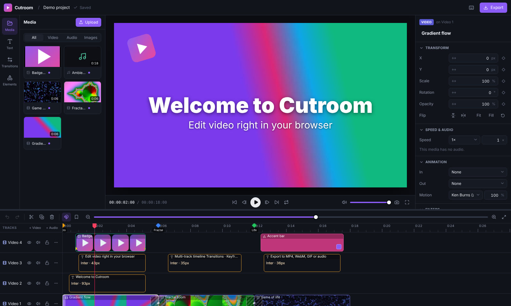
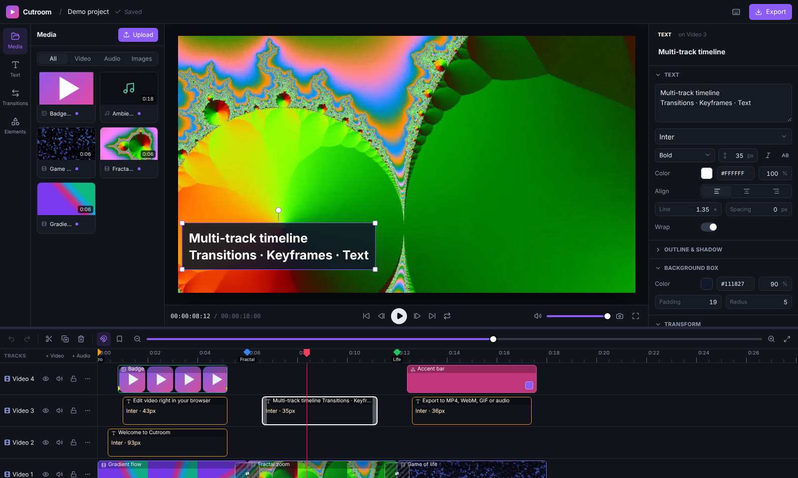
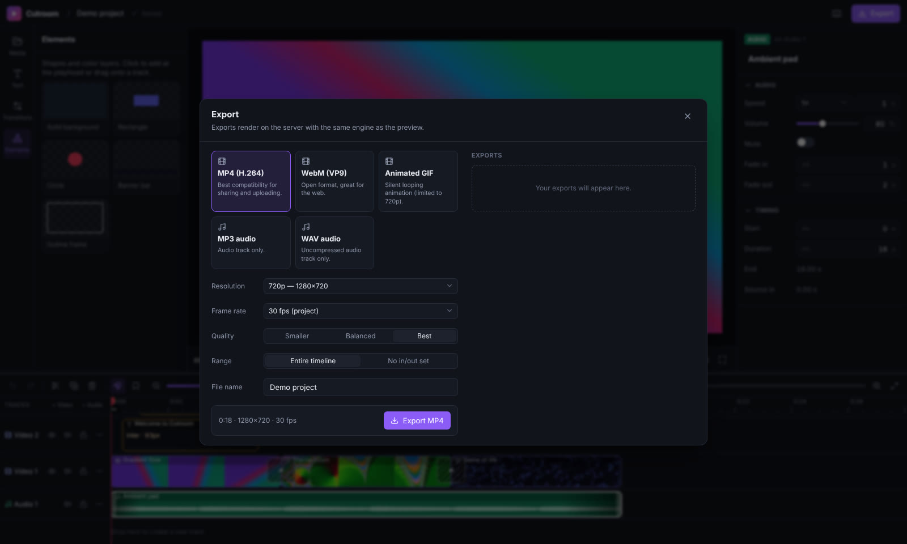
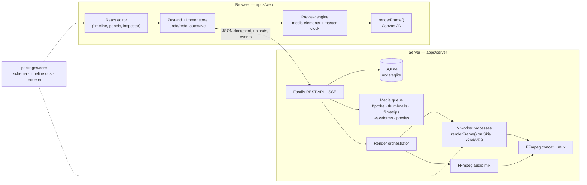

# Cutroom — video editor platform

A full-stack video editor that runs in the browser: a multi-track timeline with text, shapes,
transitions, keyframe animation and filters, a real-time preview, and server-side exports to
MP4, WebM, GIF, MP3 or WAV.



The central design choice is that **the preview and the export use the same renderer**. Every
frame is drawn by one shared TypeScript function (`renderFrame` in `packages/core`), which runs
on a `<canvas>` in the browser and on Skia (`@napi-rs/canvas`) in the export workers. Text
layout, transforms, keyframes, animations, transitions, filters and blend modes therefore look
identical in the editor and in the exported file. The same bundled fonts are loaded on both
sides.

## Features

**Editing**

- Multi-track timeline for video, audio, images, text and shapes, with any number of tracks.
  Higher tracks draw on top. Tracks can be muted, hidden, locked, renamed and reordered.
- Drag clips within a track or across tracks, with snapping to clip edges, the playhead and
  markers. A dragged clip slides into the nearest gap instead of overlapping; dropping it below
  the last track creates a new track. Box selection and multi-clip moves are supported.
- Trim either edge of a clip. Trims are limited by the source media. Also split at the playhead,
  ripple delete, duplicate, copy/cut/paste, and undo/redo with a 200-step history.
- 16 transitions: dissolves, dips, wipes, pushes, circle, clock wipe, zoom and blur. Each sits
  on the cut between two clips and uses frames from the source when the media has them.
- Speed changes from 0.1× to 16× (pitch-preserving audio), volume up to 200%, audio fades, and
  detaching a video's audio onto its own track.
- Markers, an in/out range for looped playback and range exports, and frame-accurate stepping.

**Graphics and motion**

- On-canvas transform handles: move with center/edge snap guides, scale, rotate (Shift snaps to
  15°), and double-click a title to edit its text in place.
- Keyframes for position, scale, rotation and opacity, with per-keyframe easing. Changing a
  keyframed value at the playhead adds or updates a keyframe automatically.
- In/out animations (fade, slide, rise, zoom, pop, spin, blur, wipe, typewriter) and looping
  motion (Ken Burns, pulse, float, shake, rotate).
- Text styling with 15 bundled font families: weight, italic, uppercase, alignment, line
  height, letter spacing, wrapping, outline, shadow and a rounded background box. Eight text
  presets are included (title, lower third, caption, neon, and more).
- Shapes (rectangle or ellipse, fill, stroke, corner radius), crop and flip.
- Filters: brightness, contrast, saturation, hue, blur, grayscale, sepia, invert and vignette,
  plus 11 presets, all with live thumbnails. 16 blend modes.

**Platform**

- Project dashboard with thumbnails rendered by the server. Projects can be created from
  aspect-ratio presets (16:9, 9:16, 1:1, 4:5, 4:3, 21:9), renamed, duplicated (media included)
  or deleted.
- Media library with streaming uploads and progress. Uploads are processed in the background:
  metadata via ffprobe, thumbnails, filmstrips, waveforms, and browser-friendly proxies for
  formats browsers can't play (ProRes, HEVC, MKV, AVI, TIFF…).
- Autosave with optimistic concurrency (version conflicts are detected and resolvable) and live
  updates over Server-Sent Events.
- An export queue with progress and ETA. Exports render in parallel worker processes and can
  be cancelled. You can also export a still frame as PNG.
- A "Try a demo project" button that builds a showcase project from generated, license-free
  media.
- A single Docker image (API + web app + FFmpeg) with a health check, running as a non-root
  user.

<p>
  
  
</p>

## Architecture



| Package         | What it contains                                                                                                                                                                                        |
| --------------- | ------------------------------------------------------------------------------------------------------------------------------------------------------------------------------------------------------- |
| `packages/core` | The project document schema (Zod), factories and presets, pure editing operations (placement, trims, splits, transitions, snapping…), keyframe and animation evaluation, text layout and `renderFrame`. |
| `apps/server`   | Fastify API, SQLite repositories, upload handling, the media processing queue, still/thumbnail rendering and the export pipeline.                                                                       |
| `apps/web`      | The React 19 + Tailwind 4 editor and dashboard, the preview engine, the timeline and the inspector.                                                                                                     |
| `assets/fonts`  | Bundled OFL fonts shared by the browser and the server ([licenses](assets/fonts/LICENSE.md)).                                                                                                           |

**How an export works.** The orchestrator snapshots the project document and splits the frame
range into chunks. Each chunk goes to a forked worker process. A worker decodes only the media
it needs (each video clip is decoded at the size it is drawn, streaming forward from a single
seek), draws every frame with `renderFrame` on Skia, and pipes raw RGBA into its own FFmpeg
encoder. Meanwhile one FFmpeg process mixes the audio, handling trims, speed (`atempo`), volume
and fades. The segments are then concatenated without re-encoding and muxed with the audio;
GIFs get a palette pass. The API server's event loop never does heavy work.

**The document model.** Times are in seconds. Positions are project pixels relative to the frame
center, so `x = 0, y = 0` is centered at any resolution. Media scale 1 fits the frame. Clips on
a track never overlap. A transition is a property of the incoming clip and is centered on the
cut, so adding one never changes the timeline's length. Documents are validated with the same
Zod schema on the client and the server, and they carry a `schemaVersion` for future
migrations.

## Getting started

Requirements:

- **Node.js 22.13 or newer.** The server uses the built-in `node:sqlite` module.
- **FFmpeg 6 or newer** on your `PATH`, built with libx264, libvpx-vp9, libopus and libmp3lame
  (the default builds on Debian/Ubuntu, Homebrew and the official static builds are).

```bash
npm install
npm run dev
```

`npm run dev` starts the API on <http://localhost:3001> and the editor on
<http://localhost:5173>; Vite proxies `/api` and `/fonts` to the API. Open the editor and click
**Try a demo project**, or create a project and drag some media into it.

### Production build

```bash
npm run build      # builds apps/web/dist and bundles the server into apps/server/dist
npm start          # serves the API and the web app on http://localhost:3001
```

### Docker

```bash
docker compose up --build    # http://localhost:8080, data persisted in the "cutroom-data" volume
```

The image is based on `node:22-trixie-slim` and includes FFmpeg 7. To build from a registry
mirror, pass `--build-arg NODE_IMAGE=<mirror>/node:22-trixie-slim` (or set `NODE_IMAGE` for
compose).

## Configuration

The server reads these environment variables. All are optional; see [`.env.example`](.env.example).

| Variable             | Default                   | Description                                                                                                                |
| -------------------- | ------------------------- | -------------------------------------------------------------------------------------------------------------------------- |
| `HOST` / `PORT`      | `127.0.0.1` / `3001`      | Listen address (the Docker image uses `0.0.0.0:8080`).                                                                     |
| `DATA_DIR`           | `./data`                  | SQLite database, uploads, generated previews and exports.                                                                  |
| `FFMPEG_PATH`        | `ffmpeg`                  | FFmpeg binary (`FFPROBE_PATH` likewise).                                                                                   |
| `MAX_UPLOAD_MB`      | `4096`                    | Maximum upload size.                                                                                                       |
| `MEDIA_CONCURRENCY`  | `2`                       | Media processing jobs that run at once.                                                                                    |
| `RENDER_CONCURRENCY` | `1`                       | Exports that run at once.                                                                                                  |
| `RENDER_WORKERS`     | half the CPU cores, max 4 | Worker processes per export.                                                                                               |
| `PROXY_CODEC`        | `h264`                    | Codec for preview proxies: `h264` (MP4/AAC) or `vp9` (WebM/Opus).                                                          |
| `PROXY_ALWAYS`       | `0`                       | Proxy every video and audio file. Use with `PROXY_CODEC=vp9` for browsers built without H.264 (e.g. some Chromium builds). |
| `CORS_ORIGIN`        | _(unset)_                 | Comma-separated origins allowed to call the API from another host.                                                         |
| `PUBLIC_DIR`         | auto-detected             | Built web app to serve (`apps/web/dist`).                                                                                  |
| `FONTS_DIR`          | auto-detected             | Bundled fonts (`assets/fonts`).                                                                                            |
| `LOG_LEVEL`          | `info`                    | Fastify/pino log level.                                                                                                    |

## Using the editor

- **Add media:** upload it in the Media panel (or drop files anywhere in the editor), then drag
  it onto a track or click **+** to add it at the playhead.
- **Arrange:** drag clips, drag their edges to trim, press <kbd>S</kbd> to split. Right-click a
  clip for more actions.
- **Style:** select a clip and use the inspector on the right. Click ◇ next to a transform
  property to animate it with keyframes.
- **Transitions:** hover a cut and click **+**, or drag one from the Transitions panel onto the
  cut.
- **Export:** click **Export**, pick a format, resolution, frame rate and quality, and download
  the result when it finishes. You can keep editing while it renders.

| Shortcut                                                                     | Action                              |
| ---------------------------------------------------------------------------- | ----------------------------------- |
| <kbd>Space</kbd>                                                             | Play / pause                        |
| <kbd>←</kbd> <kbd>→</kbd> (<kbd>Shift</kbd> for 1 s)                         | Step a frame                        |
| <kbd>↑</kbd> <kbd>↓</kbd>                                                    | Previous / next edit point          |
| <kbd>S</kbd> or <kbd>Ctrl</kbd>+<kbd>B</kbd>                                 | Split at the playhead               |
| <kbd>Delete</kbd> (<kbd>Shift</kbd> to ripple)                               | Delete selection                    |
| <kbd>Ctrl</kbd>+<kbd>Z</kbd> / <kbd>Ctrl</kbd>+<kbd>Shift</kbd>+<kbd>Z</kbd> | Undo / redo                         |
| <kbd>Ctrl</kbd>+<kbd>C</kbd> / <kbd>X</kbd> / <kbd>V</kbd> / <kbd>D</kbd>    | Copy / cut / paste / duplicate      |
| <kbd>M</kbd>, <kbd>I</kbd> / <kbd>O</kbd>, <kbd>X</kbd>                      | Marker, in / out point, clear range |
| <kbd>N</kbd>, <kbd>L</kbd>                                                   | Toggle snapping, toggle loop        |
| <kbd>+</kbd> / <kbd>−</kbd>, <kbd>Ctrl</kbd>+scroll                          | Zoom the timeline                   |
| <kbd>?</kbd>                                                                 | All shortcuts                       |

## HTTP API

All endpoints return JSON. Errors have the shape `{ "error": "code", "message": "…", "details"?: [] }`.

| Method & path                                                     | Description                                                                               |
| ----------------------------------------------------------------- | ----------------------------------------------------------------------------------------- |
| `GET /api/health`, `GET /api/info`                                | Health check; version, FFmpeg version and limits.                                         |
| `GET /api/fonts`, `GET /fonts/:file`                              | Font catalog and font files.                                                              |
| `GET /api/projects`                                               | List projects (summaries with thumbnail URLs).                                            |
| `POST /api/projects`                                              | Create a project `{ name, width, height, fps, backgroundColor? }`.                        |
| `POST /api/demo`                                                  | Create the demo project (generates its media with FFmpeg).                                |
| `GET /api/projects/:id`                                           | Project with its document.                                                                |
| `PUT /api/projects/:id/document`                                  | Save `{ document, baseVersion }`; `409` if the document changed since `baseVersion`.      |
| `PATCH /api/projects/:id`                                         | Rename `{ name }`.                                                                        |
| `POST /api/projects/:id/duplicate`                                | Copy a project together with its media.                                                   |
| `DELETE /api/projects/:id`                                        | Delete a project, its media and its exports.                                              |
| `GET /api/projects/:id/thumbnail`                                 | JPEG thumbnail rendered from the timeline.                                                |
| `GET /api/projects/:id/events`                                    | Server-Sent Events: asset processing and export progress.                                 |
| `GET /api/projects/:id/assets`                                    | List media.                                                                               |
| `POST /api/projects/:id/assets`                                   | Upload one file (`multipart/form-data`, field `file`).                                    |
| `GET\|PATCH\|DELETE /api/assets/:id`                              | Read, rename, or delete media (`409` while it is used on the timeline unless `?force=1`). |
| `GET /api/assets/:id/{file,preview,thumbnail,filmstrip,waveform}` | Original, browser preview, and generated data (range requests supported).                 |
| `POST /api/projects/:id/renders`                                  | Start an export `{ settings: { format, resolution, fps, quality, range, fileName? } }`.   |
| `GET /api/projects/:id/renders`                                   | List exports.                                                                             |
| `GET /api/renders/:id`                                            | Export status, progress and ETA.                                                          |
| `POST /api/renders/:id/cancel`, `DELETE /api/renders/:id`         | Cancel or delete an export.                                                               |
| `GET /api/renders/:id/download`                                   | Download the exported file.                                                               |
| `POST /api/projects/:id/still`                                    | Render a frame `{ time, resolution?, format: "png" \| "jpeg" }`.                          |

## Development

```bash
npm run typecheck     # TypeScript, all workspaces
npm run lint          # ESLint
npm run format        # Prettier
npm test              # unit + integration tests (needs FFmpeg)
npm run test:e2e      # Playwright end-to-end tests (starts its own servers)
npm run benchmark     # time exports of the demo project (args: resolution, worker counts)
```

- **Core tests** cover the timeline operations (also run inside Immer drafts, as the editor
  does), animation evaluation, schema validation, and real pixel output of the renderer,
  including every transition.
- **Server tests** use FFmpeg to generate media, exercise the API, and check real exports: frame
  counts, codecs, pixel colours, audio, GIF/MP3/WAV/WebM output, cancellation and stills.
- **End-to-end tests** cover the main flows in Chromium: upload → edit → autosave → reload →
  export → download; timeline drag, trim and transitions; dragging on the canvas and keyframes;
  and the demo project. To use a specific Chromium build, set `PW_CHROMIUM_PATH`.

## Limitations and next steps

- **No user accounts.** The platform is built for self-hosting by one person or a trusted team.
  If you expose it publicly, put it behind an authenticating reverse proxy. The data model is
  per-project, so adding users and ownership is straightforward.
- **Single-node job queue.** The media and export queues are in-process. Exports already run in
  separate processes; scaling across machines would need an external queue.
- **Export speed.** Exports render on the CPU. On a 4-core machine the demo project exports at
  about 1.3× real time at 720p and 0.6× real time at 1080p. The ceiling is reading pixels back
  from Skia and encoding with x264; more cores (and `RENDER_WORKERS`) scale it. Run
  `npm run benchmark -- 1080 2,4` to measure your machine, and set `RENDER_PROFILE=1` to log
  where each worker spends its time.
- **Browser support.** Previews use canvas filters, which current Chrome, Edge and Firefox
  support. Without them (older Safari) the preview omits filters, but exports still apply them.
- **Not yet built:** chroma key, LUTs, audio effects beyond volume and fades, reverse playback,
  and caption import.

## License

No license has been chosen for this project yet. The bundled fonts keep their own open licenses
(see [`assets/fonts/LICENSE.md`](assets/fonts/LICENSE.md)).
